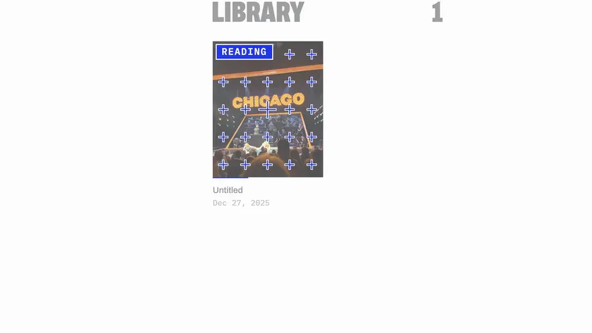
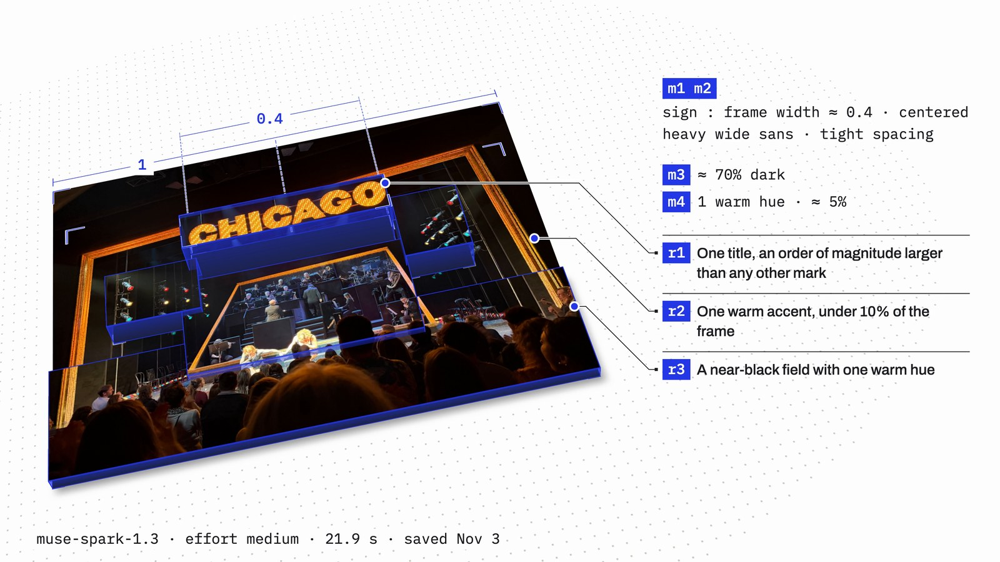
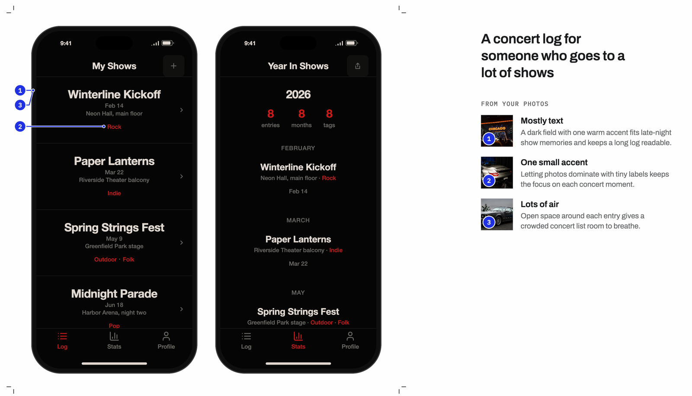
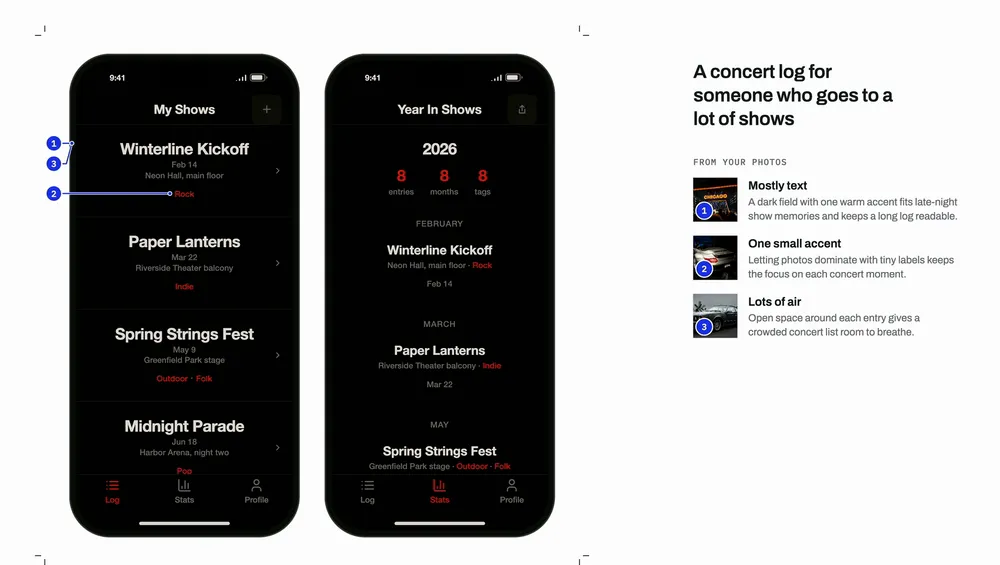
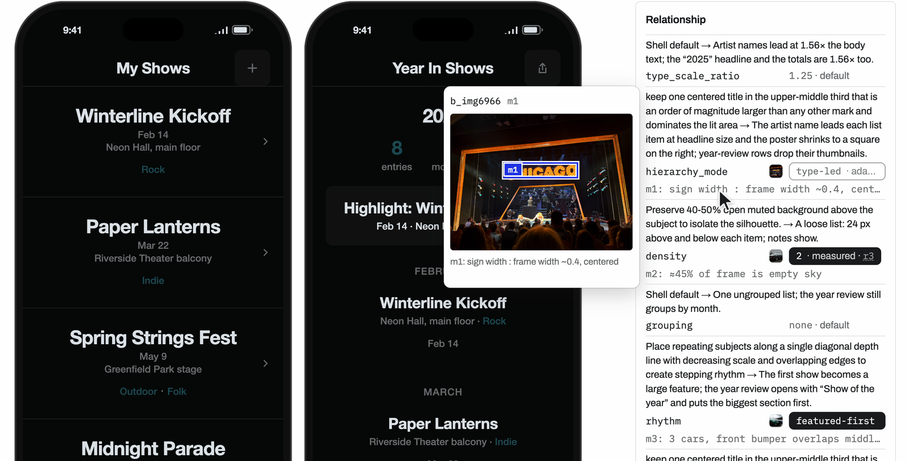
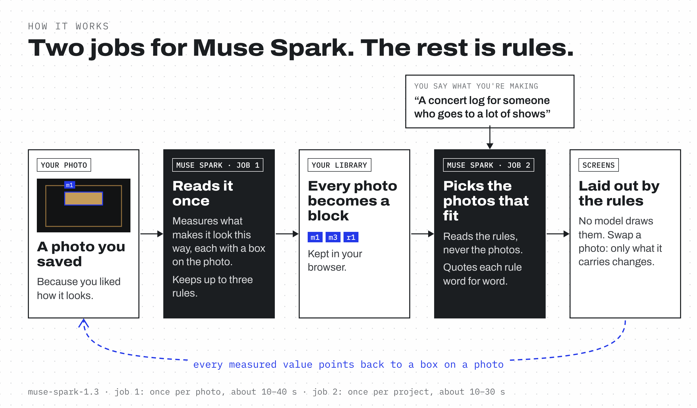

<p align="center"></p>

<p align="center"><b>Taste you can trace.</b></p>

<p align="center">Tearsheet turns the photos you already take into design rules, then lays out product screens from them, with every choice traced back to a spot on a photo.</p>

<p align="center">
  <a href="https://tearsheet.malikzhang.com"><b>Try it live</b></a> &nbsp;·&nbsp;
  <a href="https://youtu.be/_TyiYuu7dOM"><b>Watch the video</b></a> &nbsp;·&nbsp;
  Built with Muse Spark on the Meta Model API
</p>

<p align="center">
  <a href="https://youtu.be/_TyiYuu7dOM"></a>
</p>
<p align="center"><sub>Muse Spark reads a photo once: what it measured (in blue), the rules it keeps, and a tear made from the photo's own light.</sub></p>

## Try it in 60 seconds

No account and no photos of your own: twelve sample photos are already in the library.

1. Open **[tearsheet.malikzhang.com](https://tearsheet.malikzhang.com)** and click **Make**.
2. In **What are you making?**, type one sentence, for example "a reading tracker for the books I finish this year", and press Enter. Spark picks the photos in about 10–30 s.
3. Under **From your photos**, tap a photo to turn it off, then tap it again to turn it back on. A caption says what moved.
4. Click **Share**, then **Copy link**, for a read-only page with the screens and the reasons behind them.

It works the same on a phone: **Make** is in the bar at the bottom, the photos sit under the screens, and **Share** stays at the top.

## Why

Designers tear pages out of magazines to keep what they like. Most of us do the same with a phone: a stage at a show, a car in a parking garage, a poster on a wall. We save it because of how it looks.

Then a new project starts, and none of it makes it into the design. The photos sit in a camera roll. A moodboard collects them but doesn't say what to do with them. A chat can give advice, even write a page, but only if you dig the photos out and describe your taste every time, and the answer is a one-off you can't adjust piece by piece.

Tearsheet keeps what you saved as material you can build with.

## Who it's for

- **Product designers and indie developers** who build their own apps and want them to look like their taste, not a template.
- **Anyone with a camera roll full of references**: designers, photographers, people who just notice things.
- **People handing a design to a coding agent**, who want every value to arrive with a reason.

## How it works

### 1. Save a photo you like

Muse Spark reads it once, for what makes it look that way: the proportions, how dark it is, its colors, its framing. Each measurement gets a box on the photo, and up to three rules point back at what they rest on. The photo becomes a block in your library.



### 2. Say what you're making

One sentence, like "a concert log for someone who goes to a lot of shows." Spark reads the rules in your library (never the photos), picks the photos that fit, and gives the rule it picked each one for, word for word. Two screens are laid out right away. No model draws them: the rules set them.



### 3. Change anything. Trace everything.

Each photo is a block. Turn one off and what it set comes out. Swap it and only what it carries changes. Lock any value you want to keep.


<p align="center"><sub>Chicago off: type and layout come out, images come in. Back on. Then the Porsche is swapped for a BMW M4, and the accent turns from red to teal.</sub></p>

Every value says where it came from, with a chip: **measured**, **interpreted**, or **adapted**. A measured value points back to the box on the photo it was read from.



### 4. Hand it off

Share one read-only link with the screens and the reasons behind them, or export `parameters.json`, `tokens.css` and `handoff.md` for a coding agent.

## What makes it different

- **Built from your taste.** The library is the photos you already saved, not a style picked from a menu.
- **Read once, reused everywhere.** A photo is measured when you save it. Every project after that reuses its rules.
- **Traceable.** Every value says where it came from. A measured one points back to a box on a photo.
- **Changeable.** One photo is one block. Turning it off or swapping it changes only what it carries.
- **Honest about the AI.** Spark has to quote the rule it picked a photo for, character for character, or the pick is dropped. Nothing is repaired or invented.
- **Private by default.** Your library lives in your browser. A photo goes to Muse Spark once, to be read; picking sends only text.

### Compared with asking a chat

We gave the same six photos to Muse Spark as a plain chat, three times, on 2026-11-04. Same model on both sides; the difference is how it's used.

| | Muse Spark, plain chat | Muse Spark, through Tearsheet |
|---|---|---|
| What it gets | The six photos attached to one message, plus the request and two style chips (Dark, One accent) | The request, plus the rules it measured when each photo was saved |
| What it picked | Chicago and the Porsche, judged by their colors, in all three runs | Chicago, the Porsche and a BMW E24, each with the rule it quoted (the run in the video) |
| What comes back | Advice to read | Two screens, laid out by those rules |
| Changing one choice | Ask again | Tap a photo off or swap it |
| The next project | Dig the photos out and describe your taste again | The library is already there |

## Under the hood



| Job | When | What it sends | What comes back |
|---|---|---|---|
| **Read a photo** | Once, when you save it | The photo (2048 px on the long side) with one prompt and a strict JSON schema | Measurements with how they were measured, boxes on a 0–1000 grid, up to three rules mapped onto layout parameters, and the one change that would break the look |
| **Pick photos** | When you say what you're making | Your sentence and each photo's rules, as text. No photos | Up to three picks, each quoting one rule word for word, plus sample content for the screens |

Both calls use `muse-spark-1.3`. Everything after them is deterministic: sixteen parameters become CSS variables in a fixed shell, so the same rules always give the same layout. The Meta key stays on the server.

**Checked, not assumed.**
- The reading prompt and schema passed a sealed test before the product was built: three photos, one call each, judged against notes written in advance.
- Across three sealed runs, the picker quoted 27 of 27 rules word for word and never matched a photo by its subject.
- 770 tests pass. A layout contract test renders 1,320 combinations of sample photos and checks that no rule breaks: none do.
- Every live call is logged with its tokens, cost and latency. A photo costs about 1.3–2.4¢ to read; a set of picks about 1–1.6¢.

<details>
<summary><b>Run it locally</b></summary>

```bash
npm install
npm run dev          # http://localhost:5173
```

The dev server serves `/api/extract`, `/api/propose` and `/api/sync/:code` itself (the same handlers as the Vercel functions) and reads `META_API_KEY` from the environment. The key never reaches the browser. Without a key, `localStorage.setItem('tearsheet.dry', '1')` makes both model calls return the request they would have sent, and nothing leaves the server.

```bash
npm test               # unit tests
npm run test:contract  # the layout contract
npm run check:prompts  # prompts and schemas against the evaluation harness (needs it checked out as ../meta-eval)
npm run lint && npm run build
```

Deploy: Vercel, with `META_API_KEY` set and `PROPOSE_ENABLED=1` for live picks. `api/extract.ts` (up to 120 s), `api/propose.ts` and `api/sync/[code].ts` are the serverless functions.

</details>

<details>
<summary><b>Parameters and provenance</b></summary>

Relationship parameters carry the character of a photo: `type_scale_ratio`, `hierarchy_mode`, `density`, `grouping`, `rhythm`, `alignment_edge`, `image_text_dominance`, `accent_placement`, `accent_coverage`, `palette_hue_count`. Appearance parameters are the skin: `color_bg`, `color_fg`, `color_accent`, `radius`, `type_family`, `spacing_unit`. See `src/shell/params.ts`. One JSON in, one render out, no generator.

Every parameter carries a provenance chip: **measured** (its rule rests on a measurement), **interpreted** (a hypothesis or a hand remap), or **adapted** (the shell's own default, or a rule applied by Tearsheet and labeled `by rule`). Click a measured chip to see the region it was read from. Rules no parameter can carry appear in a "could not be expressed" strip, so nothing is silently dropped.

A measured value is one run's reading. Reading the same photo again can give a slightly different number, which is why every value shows where it came from.

A few readings are made by rule rather than by the model, and say so: a text measurement that names an edge sets `alignment_edge`; a measured type description maps onto a substitute font stack, or falls back to `system-ui` marked `no match`.

</details>

<details>
<summary><b>How picks are checked</b></summary>

`/api/propose` sends the sentence and, for every ready photo, its id and its rules with their parameters. No photo, measurement or hypothesis leaves the device. The answer is constrained to `{ picks: [{ brick_id, quoted_rule, why }], ranking, content }`, with `store: false`.

Each pick must quote one of that photo's rules character for character. A pick that paraphrases, names an unknown photo, repeats one or comes fourth is dropped and reported, never repaired. If nothing survives, or the call fails, Enter opens **Pick photos myself** with one line of text. The accepted set is recorded on the project: `parameters.json` holds the whole record, and `handoff.md` says for each photo how it got there.

Guards on the functions: 20 calls an hour per address and 300 a day, counted in memory on each server instance, so they are best effort.

</details>

<details>
<summary><b>Sharing and sync</b></summary>

**Sharing a project** (Make → Share) uploads the project and the person's own photos it uses under a code of its own, and opens as a read-only page at `/shared?code=…&project=…`. It never sends the library's code, adopts nothing and saves nothing on the device that opens it. The sample photos ship with the app and never travel. Anyone with a share link can change what that link shows; sharing again restores it. Links can't be revoked.

**Sync** opens a library on another device with a six-character code, shown as text and as a QR code on `/sync`. There is no account, no listing endpoint and no index; the code is the only key. Photos are stored at 2048 px in a Vercel Blob store, merged by id on the second device, and `Forget this code` deletes them.

</details>

<details>
<summary><b>Project layout</b></summary>

```
api/extract.ts          image in, brick out (the key stays server-side)
api/propose.ts          sentence + rules in, up to three picks with verbatim quotes out
api/sync/[code].ts      a library or a shared project under a code, in a Blob store
src/lib/                schemas (zod, exactly Spark's schema), model calls, call limits, rules to parameters
src/screens/            Make (with Fine-tune and the export files inside it), Brick, Projects, Sync, Open, Shared, Instructions
src/shell/              the layout shell: parameters, list, year review, board
src/bricks/             photo, card, region overlay
src/compose/            provenance chips, parameter rows, the could-not-be-expressed strip
src/export/             parameters.json, tokens.css, handoff.md
scripts/                tests, the layout contract, prompt checks, a UI console sweep
```

The evaluation harness (prompts, sealed photos, run records) lives in a separate repository, [tearsheet-harness](https://github.com/Malik1942/tearsheet-harness).

</details>

## Where it goes next

- **Measured by mask.** Segment Anything (SAM 3.1) passed its test on 2 of 3 photos, with tight masks on sharp objects like a lit sign or taillights. Those will be measured from the mask; everything else keeps Spark's reading.
- **More kinds of screens.** Tearsheet lays out a log and a board from the same rules. More screen shapes can run on the same sixteen parameters and the same library.
- **Straight into code.** `handoff.md` already gives a coding agent every value with its source. Next is applying it to an app that already exists.

## About this build

Built by Malik Zhang for the Meta Global AI Developer Hackathon (Indie track). Everything in this repo was built during the hackathon (Oct 26 to Nov 4, 2026), except the pictures: Malik's own photos and the credited sample images below.

## Sample credits

The code is under the MIT license (see `LICENSE`). The photos in `public/samples` and `public/fixtures` are not: each keeps its source's terms. `g1`, `g2`, `c1`, `calmmouse` and `greencar` are Malik Zhang's own photos. The others were picked to cover very different looks (type only, image only, an all-over pattern, mostly empty space, one accent, black and white, and one counterpoint) and carry their credit wherever the product shows them.

| Sample | Work | Credit | License | Source |
|---|---|---|---|---|
| `bauhaus-1923-staatliches-bauhaus-weimar` | Herbert Bayer and László Moholy-Nagy, *Staatliches Bauhaus in Weimar 1919–1923*, cover | Minneapolis Institute of Art, 1923 | Public Domain (Mia rights field) | [Mia 40353](https://collections.artsmia.org/art/40353) |
| `haeckel-1904-trochilidae-plate-99` | Ernst Haeckel, *Kunstformen der Natur*, plate 99, Trochilidae | Wikimedia Commons, 1904 | Public domain (Commons PD-old) | [Commons](https://commons.wikimedia.org/wiki/File:Haeckel_Trochilidae.jpg) |
| `iran-1260s-star-cross-luster-tiles` | Panel of star and cross tiles, Kashan | The Metropolitan Museum of Art, 1260–70 | Met Open Access, public domain | [Met 450438](https://www.metmuseum.org/art/collection/search/450438) |
| `matthews-19c-glyphography-trade-card` | Trade card for Charles H. Matthews, glyphographic draughtsman | The Metropolitan Museum of Art, 19th century | Met Open Access, public domain | [Met 813051](https://www.metmuseum.org/art/collection/search/813051) |
| `lissitzky-1923-dlya-golosa` | El Lissitzky, *Dlya Golosa* (For the Voice), page | Minneapolis Institute of Art, 1923 | Public Domain (Mia rights field) | [Mia 8553](https://collections.artsmia.org/art/8553) |
| `secession-1902-beethoven-catalogue` | Ernst Stöhr, woodcut in the catalogue of the 14th Vienna Secession exhibition (Beethoven) | Minneapolis Institute of Art, 1902 | Public Domain (Mia rights field) | [Mia 119894](https://collections.artsmia.org/art/119894) |
| `jpl-2016-visions-mars` | NASA/JPL, *Visions of the Future: Mars* | Courtesy NASA/JPL-Caltech | JPL image use policy: free to use with credit, no logos, no implied endorsement | [JPL](https://www.jpl.nasa.gov/galleries/visions-of-the-future/) |
