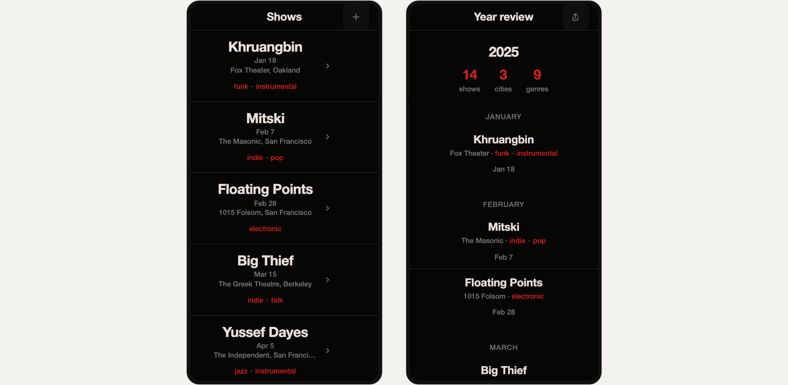
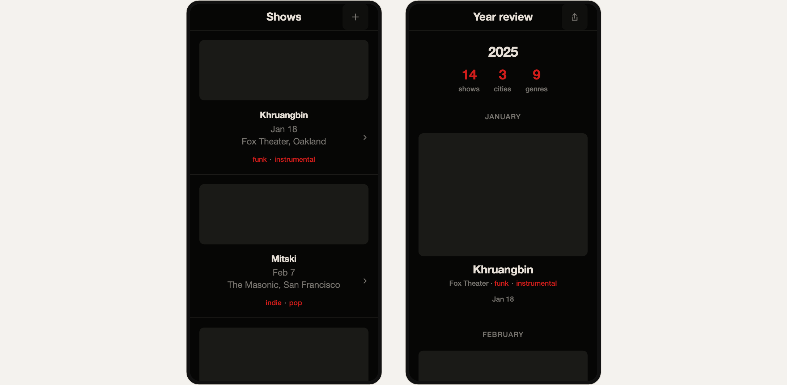
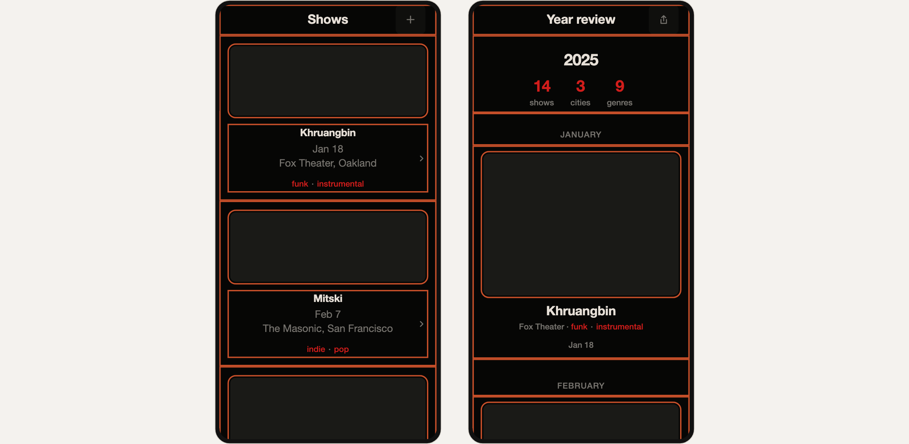

# Demo notes: the forgotten photo and the rule it carries (12_SPEC_v3 §8)

**Shot flow (Malik, Tue 2026-11-03, one-page Make):** type the intent, press Enter, tap the Chicago photo off, tap it on, Share. These notes describe the public version at `bricks-virid-nine.vercel.app`: commit 4010fa2, deployed 2026-11-03 17:03 PT. It has the swap sheet and the ranking sentence in the proposal prompt. If a later deploy changes the proposal prompt or the layout contract, check step 1 and the table again before recording.

## The photo

- **File:** `example-library/demo/IMG_6966.jpeg`, from Malik's camera roll. It sits outside the repo; only the shell renders below are committed.
- **Taken:** 2025-12-27 16:50, from the EXIF DateTimeOriginal.
- **What it shows:** a lit CHICAGO marquee sign centered over a stage, a near-black field around it, and the audience in the bottom quarter.
- **Extraction behind these notes:** muse-spark-1.3, prompt v3, effort medium, run in the harness on 2026-11-03 (`meta-eval/out/IMG_6966`, $0.0172).
  - **Before recording, check the app's own reading.** Saving the photo in the app runs a new extraction, which can word the rules differently. In Library, tap the photo, then open Details. r1 (or whichever relation names the title) should show `hierarchy_mode = type-led` with `adapted · by rule`.
  - **There is no Try again on a photo that read.** To read it again, Remove it and add it again. That is one more extraction, about 1.7¢.

## Its relations and what they set

| Relation | What it sets in the demo project | Reaches the screens? |
|---|---|---|
| r1 "keep one centered title in the upper-middle third that is an order of magnitude larger than any other mark and dominates the lit area" | `hierarchy_mode` type-led, `alignment_edge` center, `image_text_dominance` 0.2 (text-led), all `adapted · by rule`, citing r1 | Yes. The layout contract then hides the thumbnails (0.2 → 0, "one alignment axis") |
| r2 "restrict the single warm accent to under 10% of frame …", the rule the model quoted | `accent_coverage` ≤15%, measured | No: switched off by the cap of three while r1 is on |
| r3 "use a near-black field with exactly one saturated warm hue for emphasis …" | `palette_hue_count` 1, measured | No: the same cap |

- **Why r1 reads at all:** r1 gives no number. The rule table (d4b0497) reads a dominant title said in words as type-led plus text-led, and takes the alignment from the same sentence.
- **The layout contract:** a centered, type-led list has one alignment axis, so the thumbnails are hidden rather than set beside the names. Fine-tune shows the line "image share 0.2 by rule → thumbnails hidden by layout contract: one alignment axis".

## The shot

**Setup, before recording.**
- **Library:** the 12 starters (⋯ in the header → Include starters) plus the Chicago photo. The live calls below saw exactly these 13.
- **Window:** 1440 × 900. The screens, the photo row and the line under it fit without scrolling.
- **Intent and lean:** on Make, type "a concert log for someone who goes to a lot of shows". Then use the ⋯ beside the field → Adjust style… → turn on `dark` and `one accent`, and close it.
  - This is the lean of the live calls below; without it, Chicago first is untested.
  - The chips appear once the intent is typed. With the 12 starters and Chicago they are dark, one accent, airy, two colors, big titles and text-heavy.
  - The lean holds while the page stays open. A reload clears it.

**1. Enter.** Two empty frames pulse while the model looks. That took 33 s in the latest call, so plan a cut. Then the project appears: the two screens, and under them the photos that set something.
- **Expected picks:** two live calls on the public site, both with the lean dark + one accent, proposed Chicago, g2 and secession, in that order.
  - **Before the ranking sentence** (2026-11-03): 12.5 s, $0.0098.
  - **After it** (2026-11-03 17:05 PT): 33.0 s, $0.0161, 3,129 output tokens, 2,791 of them reasoning. The ranking put the same three first.
  - **Chicago's reason in the latest call,** quoting r2: "Keeps the log dark like a venue while saving a small pop for show titles so many entries stay scannable."
  - Chicago comes first: "Mostly text", with "Dec 27, 2025" under it.
  - g2, the car, has "One small accent".
  - Secession is in the project but not in the row. With Chicago on, nothing it sets shows, so it is hidden.
- **The screens:**
  - Both: a near-black field, light names, and a red accent on the tags and the totals.
  - The list: each name large and centered, the date and venue under it, no thumbnails.
  - The year review: 2025, the totals in red, months as small labels, text rows, no thumbnails.
- **Under the row:** "4 things couldn't carry over ▸".
- **Takes:** every Enter is a fresh model call, about 1.6¢ since the ranking sentence. Record up to three takes and use one with Chicago in the row; otherwise see Fallbacks.
- **The time limit:** the model call is cut off at 55 s, inside the function's 60 s. If a take runs past it, the page says "Nothing came back. Pick them yourself." That one is a retake, not a fallback.

**2. Tap Chicago off.** The project goes v1 → v2. An outline flashes on every region that changed, which is nearly all of both screens.
- **The list:** a flat image block above each show, the names at body size under it, still centered.
- **The year review:** a large image block for each show.
- **The row:** Chicago dims and its switch turns off. g2's label becomes "Big images". Secession appears in the third slot, "Centered"; the slots are fixed, so nothing moves.
- **The line:** "3 things couldn't carry over".

**3. Tap it on.** v2 → v3, the same flash, and the screens come back exactly as in step 1 (the capture is pixel-identical).

**4. Share.** The popover holds Copy link, and Download with parameters.json, tokens.css and handoff.md.
- **What goes up:** opening the popover uploads the project and the Chicago photo under the project's own share code.
- **What the link opens:** a read-only page with the two screens and the reasons behind them. Anyone with the link sees the photo.
- **What stays home:** the library's sync code never goes, and nothing else does.

| | Chicago on (v1, v3) | Chicago off (v2) | Set by |
|---|---|---|---|
| List item | Name leads, large and centered; no thumbnail | Image block above, name at body size | On: `hierarchy_mode` type-led and image share 0.2 (Chicago r1); the layout contract turns 0.2 into 0. Off: `hierarchy_mode` balanced → image-led by the layout contract; image share 0.95 (g2, measured) |
| Year review rows | Text only | An image block per show | The same values |
| Alignment | Centered | Centered | On: Chicago r1. Off: secession's caption measurement. **It does not move**, so don't credit the centering to Chicago |
| Colors and accent | Near-black, light text, red ≤5%, 2 hues | The same | g2 both times. Chicago's own color rules are capped (above) |
| Photo row | Chicago "Mostly text", g2 "One small accent" | Chicago off, g2 "Big images", secession "Centered" | Each photo's first label for what it sets |

## Fallbacks

- **Chicago in none of three takes:** use the ⋯ beside the field → Adjust style… → More like this one → the Chicago photo. "Starting from" and its thumbnail show under the field; press Enter.
  - Chicago comes first as the starting point, and the model adds up to three more.
  - The same start works from Library: tap the photo → Use in Make.
  - Say "I start from this one", not "it found it".
  - The other picks may differ from g2 and secession, so check the frames against the table before recording.
- **Still not usable:** use the ⋯ beside the field → Pick photos myself… → Chicago, g2, secession → Show the screens. The screens match the table in either order. Say "I picked these three".

## Narration facts

- **"Found it"** is fine in a take where the model proposed Chicago, not in a fallback take.
- **The date.** The Library card and the Make row both show "Dec 27, 2025" under Chicago, the day it was taken. Details and Fine-tune show both dates: "taken Dec 27, 2025 · saved …". The narration matches: "a photo from last December's show". IMG_6966.jpeg reads 2025-12-27 in a dry import in the dev build.
  - The iPhone path is untested: after importing on the phone, check that the card shows "Dec 27, 2025".
  - If it shows "saved …" instead, iOS did not pass the capture date. Then either import that photo on desktop from the original file, or keep the narration without pointing at the date.
- **Comparison line, verbatim:** "The chat picked it because it's a concert. Tearsheet picked it because of a rule, and it never saw the photo."
- **What the proposal quoted.** The model picked Chicago for its accent rule (r2), and r2 does not reach the screens (the cap of three). What the photo changes comes from its title rule (r1), which the product reads by rule.
  - Say "the photo it found also carries a rule about the title", not "the model proposed the title rule".
  - The red on screen is g2's (its taillights), not Chicago's warm accent.
- **What the tap shows.** The title rule makes the names lead. With everything centered, the layout contract then drops the thumbnails rather than set them beside the names.
  - "Chicago's rule removes the pictures" is half true.
  - "Its rule makes the names lead, and with everything centered the pictures go" is accurate.
- **What not to credit to Chicago:** the centering (secession sets it when Chicago is off) and the colors (g2).

## Second beat: cut

The conflict beat from the step pages ("they compete for image share; I chose Chicago's") shows nothing now. Don't record it.
- **What happens:** in Fine-tune, any of the three image-share values (Chicago 0.2, g2 0.95, secession 0.7) leaves both screens as they are. Only the sheet's line changes.
- **Why:** Chicago's r1 keeps the list type-led and centered, and the layout contract hides the thumbnails of a centered, type-led list.

## Fixes found while recording

- **Type-led poster column** (f7d153f): below an image share of about 0.28, the poster column was narrower than the poster's 48 px minimum, so the square was clipped at the right edge. The column now has a 48 px floor.
- **Side-by-side text column:** with poster and text side by side and a high image share, the text was left about 60 px on a phone-width screen, so names broke mid-word and buttons were cut off. The text column now keeps at least 9em, and the poster shrinks instead. The sheet now says "Posters take up to P% … (less on a narrow screen, so names stay whole)".

## Earlier takes (superseded)

- **The step pages, r1 toggled in Compose (2026-11-03 afternoon).** Accept all → Compose with Neutral skin, then uncheck Chicago's r1 and check it again (v1 → v2 → v3). Before the layout contract, r1 off put the posters beside the names. Files: `demo/toggle_contact.png`, `demo/concert_t_{on,off}_{list,review,flash}.png`.
- **The hand-picked swap.**
  - g2 + bauhaus + greencar was picked by hand, greencar was swapped for Chicago, then Chicago's 0.2 was chosen in the image-share conflict.
  - Files: `demo/concert_swap_contact.png`, `concert_v{1,2,3}_*.png`.
  - In that take the "Show of the year" card disappeared because greencar left, not because of Chicago.

## Files

- `demo/onepage_{1_on,2_off,2_off_flash}.png`: the two screens at 2×, shells only. Step 3's frame is step 1's.
- **Reproducing them:** `.superpowers/demo/onepage-demo.mjs` (git-excluded) runs Playwright on the dev server at :5175.
  - It answers `/api/propose` with the live response of 2026-11-03, so no model call is made.
  - It answers the sync locally, so nothing reaches the Blob store.
- **Kept local** because they show Malik's photo:
  - the page captures with the photo row: `.superpowers/demo/onepage-1705/*_page.png`;
  - the live proposal screenshot: `.superpowers/demo/live_propose_after.png`.
- The step-page captures came from `toggleshots.mjs` and `swapshots.mjs` (git-excluded).
