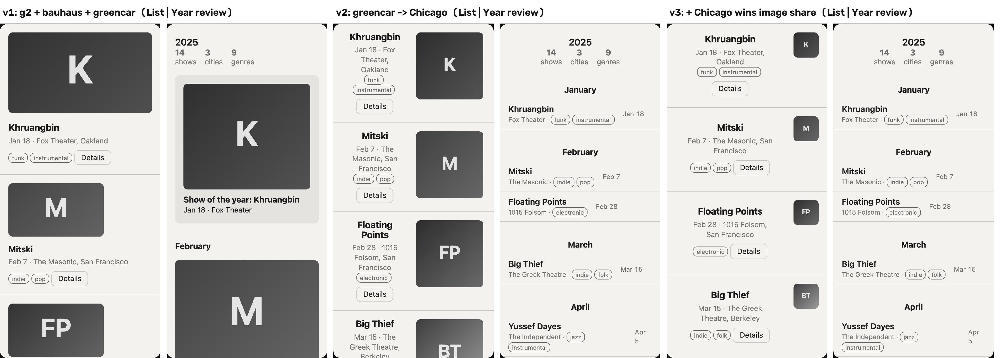

# Demo notes: the structural swap (12_SPEC_v3 §8)

Recorded Tue 2026-11-03 in the dev build (spec-v2 at d4b0497 plus the shell.css fix below).

## The photo

- **File:** `example-library/demo/IMG_6966.jpeg`, from Malik's camera roll. It sits outside the repo; only the shell renders below are committed.
- **Taken:** 2025-12-27 16:50, from the EXIF DateTimeOriginal.
- **What it shows:** a lit CHICAGO marquee sign centered over a stage, a near-black field around it, and the audience in the bottom quarter.
- **Extraction:** muse-spark-1.3, prompt v3, effort medium, run in the harness on 2026-11-03 (`meta-eval/out/IMG_6966`, $0.0172). It has not been re-extracted. The app's own extraction on save is a new sample and may read differently.

## Its relations and what they set

| Relation | Filed under | What it sets | Label |
|---|---|---|---|
| r1 "keep one centered title in the upper-middle third that is an order of magnitude larger than any other mark and dominates the lit area" | image_text_dominance | `image_text_dominance` 0.2 (text-led), `hierarchy_mode` type-led, `alignment_edge` center | `adapted · by rule`, citing r1 (rests on m1, m2, m4) |
| r2 "restrict the single warm accent to under 10% of frame …" | accent_coverage | `accent_coverage` ≤15% | measured |
| r3 "use a near-black field with exactly one saturated warm hue for emphasis …" | palette_hue_count | `palette_hue_count` 1; because r2 sets coverage, the accent stays | measured |

**Why r1 reads at all.** r1 states no number. Before d4b0497 it read as "no value could be read from the rule". The rule table now reads a dominant title said in words ("an order of magnitude larger", "the title dominates", "one centered title") as type-led and text-led, and takes the alignment from the same sentence.

**Cap of three.** On its own, the brick sets five parameters. r1's three readings fill the cap, so r2 and r3 appear under "Switched off: cap of three", each with a swap-in.

## The shot

**Setup:**
- Project: "a concert log for someone who goes to a lot of shows".
- Bricks: g2, bauhaus and greencar, picked by hand. The dev build makes no live proposal.
- Neutral skin is on and the view is Both.
- **Swap greencar → Chicago** takes the project from v1 to v2.

**What moved, v1 → v2, and why:**

| Where | v1 | v2 | Cause |
|---|---|---|---|
| List item | Poster full width above the text | Artist name leads, centered; poster is a square on the right | Chicago r1: `hierarchy_mode` image-led → type-led, `alignment_edge` left → center |
| Year review rows | Thumbnails beside each show | Text-only rows; month headings and the 2025 header centered | the same two values |
| Year review top | "Show of the year" feature card; larger first item | Gone | `rhythm` featured-first → uniform, because greencar's r3 left with greencar. **Not Chicago.** |

**What did not move in v2:**
- `image_text_dominance` stays at g2's 0.95. The top brick wins the conflict with Chicago's 0.2, so the poster square stays large and the centered text column wraps to three lines.
- `type_scale_ratio` stays at bauhaus's 1.125, so names lead at only 1.27× the body text. "An order of magnitude larger" is not carried over: no brick in this project reads it as a ratio.

**v3, one more click:** choose Chicago's tile in the `image_text_dominance` conflict (`adapted · by you`). The posters shrink to 48 px squares and the name column owns the item. **This is the clearer still for the video.**

**How general the result is:** the swap flips `hierarchy_mode` in 900 of the 1,320 ordered three-brick sets drawn from the 12 samples. It does so whenever neither of the first two bricks sets `hierarchy_mode` (only g1 and greencar do).

**Fix found while recording:** under type-led, the poster column is image share × 60% of the item. Below an image share of about 0.28 that column is narrower than the poster's 48 px minimum, so the square overflowed and was clipped at the right edge. `shell.css` now gives the column a 48 px floor. The sheet still says "a square up to 12% of the item's width" at 0.2, where the floor makes it about 16%; that wording goes to the final review.

## Recording (10 s)

1. Compose with Neutral skin on and Both selected.
2. Swap on greencar → Chicago. For one second, the C11 outline marks the moved regions (`concert_v2_flash.png`).
3. Optionally, click Chicago's tile in the `image_text_dominance` conflict.

## Files

- `demo/concert_v{1,2,3}_{list,review}.png`: the shell at 2×.
- `demo/concert_swap_contact.png`: all six side by side.
- `demo/concert_v2_flash.png`: both shells 250 ms after the swap.
- Reproduce the captures with `.superpowers/demo/swapshots.mjs` (git-excluded): Playwright on the dev server at :5175, seeded with the harness extraction, so no API call.
