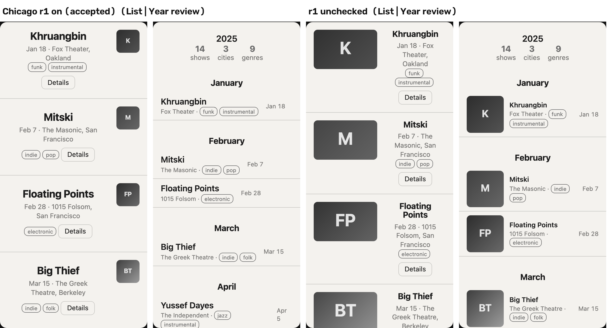

# Demo notes: the forgotten photo and the rule it carries (12_SPEC_v3 §8)

**Shot flow (Malik, Tue 2026-11-03):** the proposal surfaces the photo, then one checkbox shows what its rule does. The public version these notes describe is the one at `bricks-virid-nine.vercel.app` from 2026-11-03.

## The photo

- **File:** `example-library/demo/IMG_6966.jpeg`, from Malik's camera roll. It sits outside the repo; only the shell renders below are committed.
- **Taken:** 2025-12-27 16:50, from the EXIF DateTimeOriginal.
- **What it shows:** a lit CHICAGO marquee sign centered over a stage, a near-black field around it, and the audience in the bottom quarter.
- **Extraction behind these notes:** muse-spark-1.3, prompt v3, effort medium, run in the harness on 2026-11-03 (`meta-eval/out/IMG_6966`, $0.0172).
  - **Before recording, check the app's own reading.** Saving the photo in the app runs a new extraction, which can word the rules differently. Open its Brick screen: r1 (or whichever relation names the title) should show `hierarchy_mode = type-led` with `adapted · by rule`. If nothing structural reads, use `Try again` once.

## Its relations and what they set

| Relation | Filed under | What it sets | Label |
|---|---|---|---|
| r1 "keep one centered title in the upper-middle third that is an order of magnitude larger than any other mark and dominates the lit area" | image_text_dominance | `image_text_dominance` 0.2 (text-led), `hierarchy_mode` type-led, `alignment_edge` center | `adapted · by rule`, citing r1 |
| r2 "restrict the single warm accent to under 10% of frame …" | accent_coverage | `accent_coverage` ≤15% | measured |
| r3 "use a near-black field with exactly one saturated warm hue for emphasis …" | palette_hue_count | `palette_hue_count` 1; because r2 sets coverage, the accent stays | measured |

- **Why r1 reads at all:** r1 gives no number. The rule table (d4b0497) reads a dominant title said in words as type-led plus text-led, and takes the alignment from the same sentence.
- **Cap of three:** r1's three readings fill the cap, so r2 and r3 sit under "Switched off: cap of three" while r1 is on.

## The shot

**1. Proposal.** Intent "a concert log for someone who goes to a lot of shows", lean `dark` + `one accent`, library = the 12 starters plus the Chicago photo.
- On the public site (2026-11-03, one live call, $0.0098) the model proposed:
  1. **Chicago first**, quoting r2 ("restrict the single warm accent…"), with the reason "A dark log with a tiny warm title accent reads like a venue at night and makes each show title easy to scan."
  2. Then g2 and secession.
- **Takes:** the proposal is a fresh call each time. Record the proposal page up to three times and use a take where Chicago appears. If none of the three has it, use "More like this one" with Chicago as the starting point, and say what that shows: "I start from this one".

**2. Accept all → Compose**, Neutral skin on, Both. Chicago sits on top. Its r1 readings lead: the name leads, centered, and the poster is a small square on the right. The year review has text rows with no thumbnails.

**3. Uncheck Chicago's r1, then check it again.** Each click is a version (v1 → v2 → v3), and the outline marks the regions that moved.

| | r1 on (accepted) | r1 unchecked | Set by |
|---|---|---|---|
| List item | Name leads, centered; small square poster on the right | Poster beside the name, about half the item; name centered beside it | `hierarchy_mode` type-led → balanced (Chicago r1 → nobody); `image_text_dominance` 0.2 → 0.95 (Chicago r1 → g2) |
| Year review rows | Text only | Thumbnails beside each show | `hierarchy_mode` |
| Alignment | Centered | Centered | Chicago r1 → secession's caption measurement. **It does not move**, so don't credit the centering to r1 in the voiceover |
| Accent and hue | ≤5%, 2 hues (g2) | ≤15%, 1 hue (Chicago r2 and r3 take the freed cap slots) | Not visible under Neutral skin |

Re-checking r1 gives exactly the frame it started from (pixel-identical capture).

**4. Second beat, only if time allows: `adapted · by you`.**
1. Pick the composition with g2 on top. The image-share conflict then resolves to g2's 0.95, and the title stays type-led.
2. In the conflict, choose Chicago's 0.2. The posters shrink to small squares, and the row shows `image_text_dominance 0.2 · adapted · by you`.
3. Say: "they compete for image share; I chose Chicago's".

Cut this beat first if time runs short.

## Narration facts

- **Proposal card date.** Since this deploy, a photo whose JPEG carries an EXIF capture date shows both dates: "taken Dec 27, 2025 · saved Nov 3". A photo without one shows "saved …" alone. The narration matches the card: "a photo from last December's show". IMG_6966.jpeg reads 2025-12-27 in a dry import in the dev build. The iPhone path is untested: after importing on the phone, check that the card shows "taken …". If it shows "saved" alone, iOS did not pass the capture date. Then import that photo on desktop from the original file, or keep the narration to "a photo from last December's show" without pointing at the card.
- **Comparison line, verbatim:** "The chat picked it because it's a concert. Tearsheet picked it because of a rule, and it never saw the photo."
- **What the proposal quoted.** The model picked Chicago for its accent rule (r2). The structural change comes from the same photo's title rule (r1), which the product reads by rule. Say "the photo it found also carries a rule about the title", not "the model proposed the title rule".
- **What not to credit to Chicago:** the centering (secession sets it too) and the colors (Neutral skin hides them).

## Fixes found while recording

- **Type-led poster column** (f7d153f): below an image share of about 0.28, the poster column was narrower than the poster's 48 px minimum, so the square was clipped at the right edge. The column now has a 48 px floor.
- **Side-by-side text column:** with poster and text side by side and a high image share, the text was left about 60 px on a phone-width screen, so names broke mid-word and buttons were cut off. The text column now keeps at least 9em, and the poster shrinks instead. The sheet now says "Posters take up to P% … (less on a narrow screen, so names stay whole)".

## The earlier take (hand-picked, superseded)

Before the live proposal, the shot was a Swap. The project g2 + bauhaus + greencar was picked by hand, greencar was swapped for Chicago, and then Chicago's 0.2 was chosen in the image-share conflict (`demo/concert_swap_contact.png`, `concert_v{1,2,3}_*.png`). In that take, the "Show of the year" card disappeared because greencar left, not because of Chicago. The swap flips `hierarchy_mode` in 900 of the 1,320 ordered three-brick sets from the 12 samples.

## Files

- `demo/concert_t_{on,off}_{list,review}.png`: the toggle at 2×.
- `demo/toggle_contact.png`: the four side by side.
- `demo/concert_t_{off,on}_flash.png`: both shells 250 ms after each click.
- Reproduce the captures with `.superpowers/demo/toggleshots.mjs` and `swapshots.mjs` (git-excluded): Playwright on the dev server at :5175, seeded with the harness extraction, so no API call.
- The live proposal screenshot shows Malik's photo, so it stays local: `.superpowers/demo/live_propose_after.png` (git-excluded).
