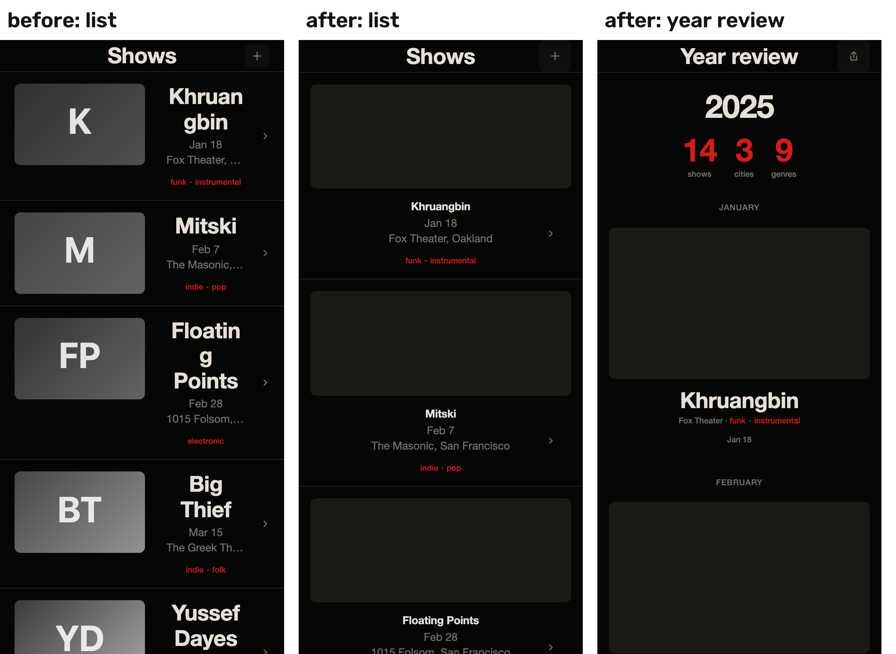

# Layout contract (layer 2)

**What it is:** `src/shell/contract.ts` takes the resolved parameters and returns parameters the shell can lay out honestly, plus every value it changed.
- **Where it runs:** last in `resolveProject`, so the screens, the Fine-tune sheet, versions, the change highlight, `parameters.json`, `tokens.css`, `handoff.md` and the share link all use the same values. `Shell` runs it again before drawing, so a screen rendered from other parameters (a mini-preview, a conflict tile) holds too. A second pass changes nothing.
- **How a change is recorded:** each changed value becomes `adapted · by rule`, with source `layout contract: <rule>`, and the value it replaced kept whole as `before`. The sheet and the `tokens.css` comments say both, for example *image share 0.95 measured → thumbnails hidden by layout contract: one alignment axis*.
- **What it reads:** parameters only, never a brick's measurements, so the SAM branch needs no change for it.

## The rules

| # | Rule | How it holds |
|---|---|---|
| 1 | One alignment axis per screen | Under `center`: balanced becomes image-led (thumbnail above the text), type-led hides the thumbnails (image share 0), alternating becomes uniform. The year review's rows and month labels follow the screen's edge (shell.css). |
| 2 | Spacing only from 4 8 12 16 24 32 48 (× spacing_unit) | Side margins 16 (were 20). Title → meta 4, meta → tags 8. Item padding 32 24 16 16 as density goes 1 2 4 6 (density 6 was 12). The text column's percentage paddings are gone. A spacing unit outside 4–16 px snaps to 8px. |
| 3 | At most three type sizes per screen | Already held: one type scale, three sizes a screen. |
| 4 | No empty band over 24 px in a list item; text column ≥ 9em; tap targets ≥ 44 px | Top-bar controls 44 × 44 (were 34 × 32). The measure counts the text, not the chevron's padding. Alternating side-by-side rows swap their columns with the poster, so the text keeps its 9em. |
| 5 | No duplicated information | The year appears once, in the year review's head; the top bar says "Year review". |
| 6 | No text inside thumbnails | Posters and thumbnails are flat surface blocks: no image, no initials. |

## Measured

`npm run test:contract` renders every ordered three-brick composition of the 12 samples (1,320; 611 distinct parameter sets) on both screens at 390 × 844 in Chromium. It measures the DOM against the six rules and fails on any violation. Plain `npm test` skips it, because it needs a browser and a dev server.

| Rule | Before (`baseline/REPORT.md`) | After (`REPORT.md`) |
|---|---|---|
| one alignment axis | 600 | 0 |
| spacing scale | 1,320 | 0 |
| three type sizes | 0 | 0 |
| readable item | 1,320 | 0 |
| no duplicated information | 0 | 0 |
| no text in thumbnails | 1,320 | 0 |
| **compositions breaking any rule** | **1,320** | **0** |

**The three worst before**, all `g2` + a center-aligned brick (`matthews` or `secession`): `baseline/worst-{1,2,3}-list.png`.
- **What was wrong:** centered names beside big thumbnails, words broken mid-name, initials in the thumbnails, 32 px controls.
- **After:** `after-{1,2,3}-{list,review}.png`, and side by side in `before-after-1.png`.

