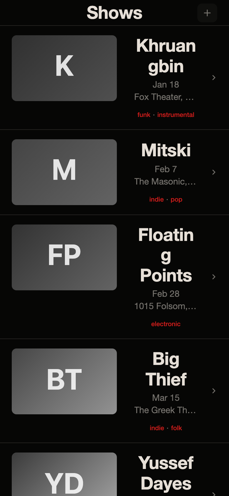
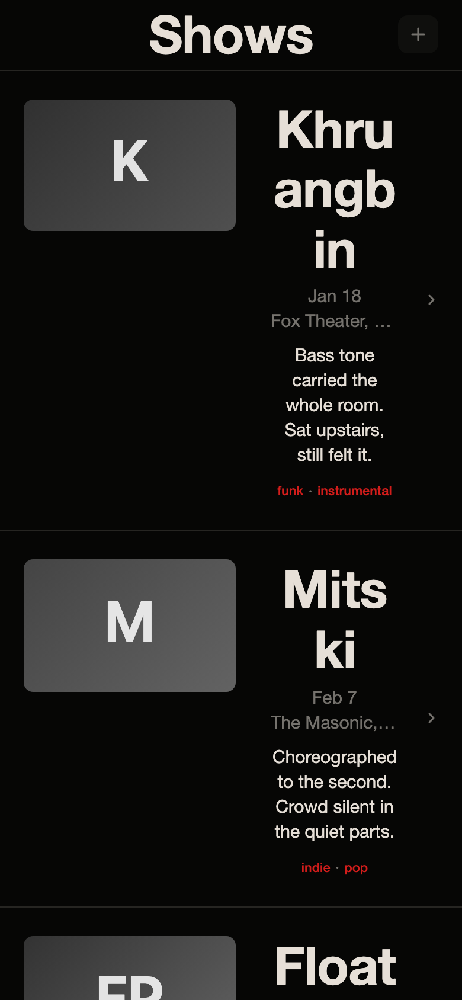
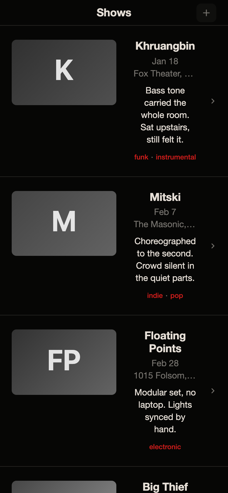

# Layout contract report

2026-11-03 22:32 UTC · 1320 compositions (ordered triples of the 12 samples), 611 distinct parameter sets, both screens at 390 × 844.

**1320 of 1320 compositions break at least one rule.**

| Rule | Compositions breaking it | List | Year review |
|---|---|---|---|
| one alignment axis | 600 | 420 | 600 |
| spacing scale | 1320 | 1320 | 1320 |
| three type sizes | 0 | 0 | 0 |
| readable item | 1320 | 1320 | 1320 |
| no duplicated information | 0 | 0 | 0 |
| no text in thumbnails | 1320 | 1320 | 1320 |

## The three worst

### 1. g2 + calmmouse + matthews-19c-glyphography-trade-card (list; 3 compositions render the same)

- list · **one alignment axis**: 14 list thumbnails beside or below their centered text
- list · **spacing scale**: .bar paddingLeft 20.0; .bar paddingRight 20.0; .item paddingLeft 20.0; .item paddingRight 40.0; .text paddingLeft 13.5; .text paddingRight 13.5
- list · **readable item**: text column 108px < 9em; .action target 34×32
- list · **no text in thumbnails**: 14 thumbnails hold an image or text
- review · **one alignment axis**: center: .bar-title .screen-title .group-title; left: .title
- review · **spacing scale**: .bar paddingLeft 20.0; .bar paddingRight 20.0; .review-head paddingLeft 20.0; .review-head paddingRight 20.0; .group-title paddingLeft 20.0; .group-title paddingRight 20.0
- review · **readable item**: .bar-icon target 34×32
- review · **no text in thumbnails**: 14 thumbnails hold an image or text

### 2. g2 + c1 + matthews-19c-glyphography-trade-card (list; 2 compositions render the same)

- list · **one alignment axis**: 14 list thumbnails beside or below their centered text
- list · **spacing scale**: .bar paddingLeft 20.0; .bar paddingRight 20.0; .item paddingLeft 20.0; .item paddingRight 40.0; .text paddingLeft 13.5; .text paddingRight 13.5
- list · **readable item**: text column 108px < 9em; .action target 34×32
- list · **no text in thumbnails**: 14 thumbnails hold an image or text
- review · **one alignment axis**: center: .bar-title .screen-title .group-title; left: .title
- review · **spacing scale**: .bar paddingLeft 20.0; .bar paddingRight 20.0; .review-head paddingLeft 20.0; .review-head paddingRight 20.0; .group-title paddingLeft 20.0; .group-title paddingRight 20.0
- review · **readable item**: .bar-icon target 34×32
- review · **no text in thumbnails**: 14 thumbnails hold an image or text

### 3. g2 + c1 + secession-1902-beethoven-catalogue (list; 2 compositions render the same)

- list · **one alignment axis**: 14 list thumbnails beside or below their centered text
- list · **spacing scale**: .bar paddingLeft 20.0; .bar paddingRight 20.0; .item paddingLeft 20.0; .item paddingRight 40.0; .text paddingLeft 13.5; .text paddingRight 13.5
- list · **readable item**: text column 108px < 9em; .action target 34×32
- list · **no text in thumbnails**: 14 thumbnails hold an image or text
- review · **one alignment axis**: center: .bar-title .screen-title .group-title; left: .title
- review · **spacing scale**: .bar paddingLeft 20.0; .bar paddingRight 20.0; .review-head paddingLeft 20.0; .review-head paddingRight 20.0; .group-title paddingLeft 20.0; .group-title paddingRight 20.0
- review · **readable item**: .bar-icon target 34×32
- review · **no text in thumbnails**: 14 thumbnails hold an image or text

