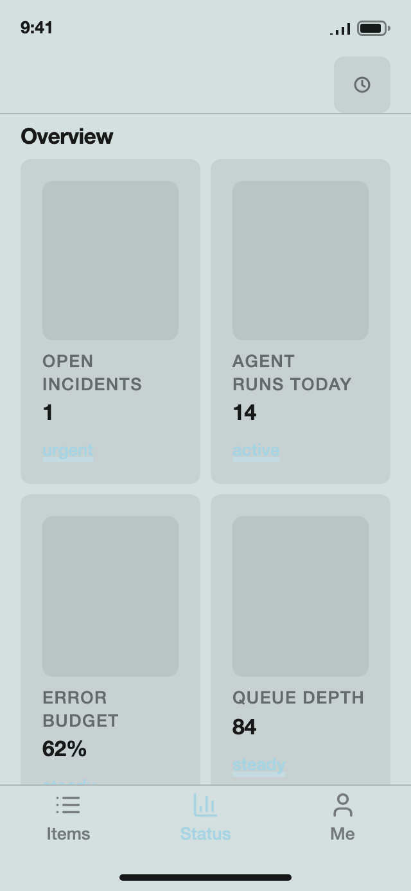
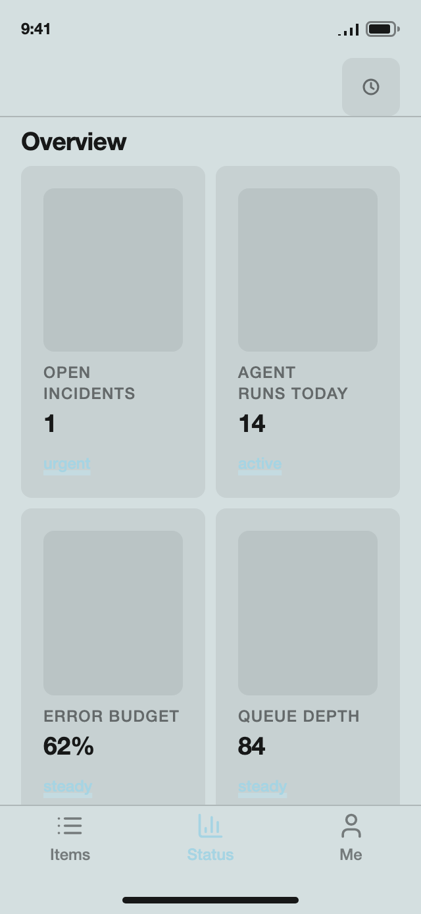
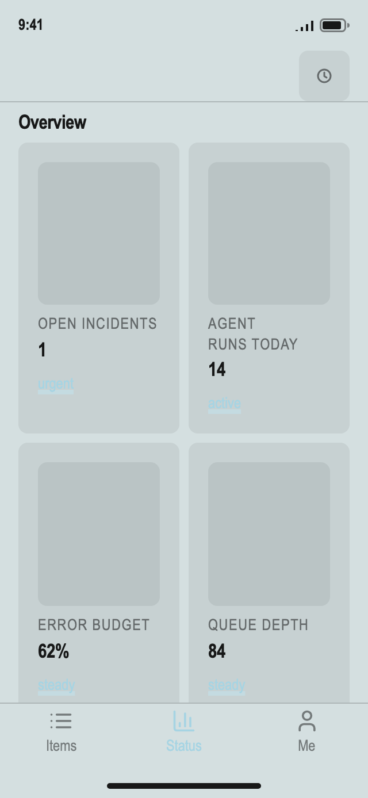

# Layout contract report

2026-11-04 14:08 UTC · 1320 compositions (ordered triples of the 12 samples), 554 distinct parameter sets, both screens (board and list) at 320 × 694, with the ops-board content.

**152 of 1320 compositions break at least one rule.**

| Rule | Compositions breaking it | board | list |
|---|---|---|---|
| one alignment axis | 0 | 0 | 0 |
| spacing scale | 0 | 0 | 0 |
| three type sizes | 0 | 0 | 0 |
| readable item | 152 | 152 | 0 |
| no duplicated information | 0 | 0 | 0 |
| no text in thumbnails | 0 | 0 | 0 |
| whole words | 0 | 0 | 0 |

## The three worst

### 1. g1 + g2 + bauhaus-1923-staatliches-bauhaus-weimar (board; 1 composition render the same)

- board · **readable item**: tile text column 106px < 9em

### 2. g1 + g2 + lissitzky-1923-dlya-golosa (board; 1 composition render the same)

- board · **readable item**: tile text column 106px < 9em

### 3. g1 + bauhaus-1923-staatliches-bauhaus-weimar + g2 (board; 1 composition render the same)

- board · **readable item**: tile text column 106px < 9em

